<div align="center">


# FIAP Switch

**Energia, inventário e verificação dos computadores dos laboratórios.**

[](https://github.com/5forzin/fiap-switch/actions/workflows/ci.yml)

[Painel](https://fiap-switch.18.223.245.218.sslip.io/) · [Telas](#o-painel) · [Arquitetura](#como-funciona) · [Instalação](#executar-localmente) · [Operação](docs/operations.md) · [Segurança](SECURITY.md)

</div>

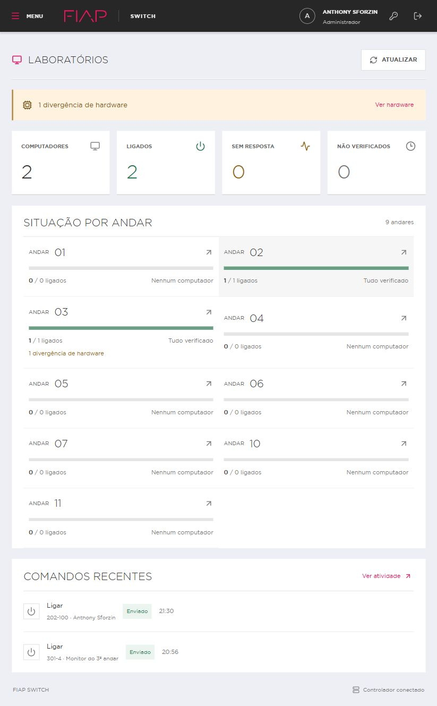

O FIAP Switch centraliza o trabalho dos monitores: consultar os computadores do andar, conferir o hardware e enviar comandos de energia. O suporte acompanha todo o prédio; o administrador gerencia as contas e define o andar de cada monitor.

Em **AWS ou Azure**, o site consulta o estado e a configuração das máquinas e executa os comandos pelas APIs do provedor, sem controlador externo. Em **FIAP produção**, um programa assinado para Windows ou Linux conecta o servidor da LAN ao site por HTTPS. Esse servidor usa WinRM e Wake-on-LAN, sem instalar agentes nos computadores dos laboratórios.

## O painel

### Computadores por andar

Seleção inicial de andar e laboratório, busca por IP ou nome e páginas de 50 máquinas. Os andares atendidos são **1, 2, 3, 4, 5, 6, 7, 10 e 11**.

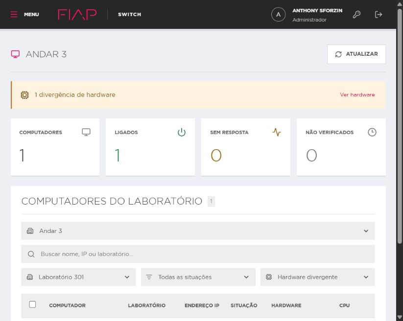

### Inventário e hardware

Cada sala tem seu próprio padrão de CPU, RAM, armazenamento, quantidade de discos e GPU. A comparação pode exigir o inventário exato ou capacidades mínimas. Uma divergência registra o equipamento, os valores esperados e detectados e a data da primeira ocorrência.

<table>
<tr>
<td width="50%">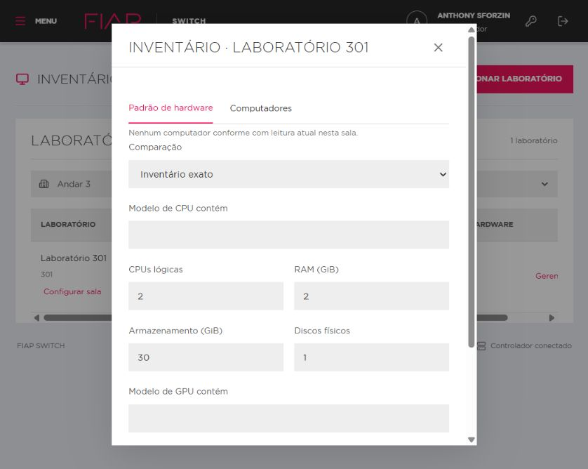</td>
<td width="50%">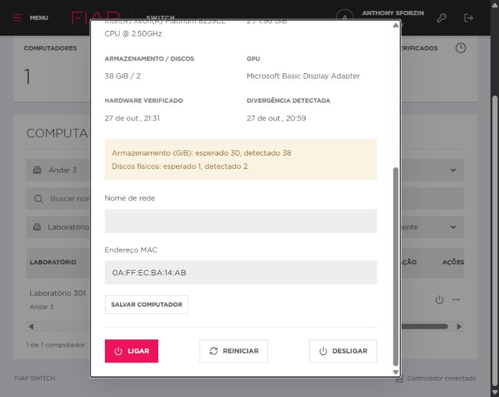</td>
</tr>
<tr>
<td align="center">Padrão configurável por laboratório</td>
<td align="center">Divergência de hardware com data</td>
</tr>
</table>

Para configurar uma sala, abra **Inventário → andar → Configurar sala**. Na aba **Padrão de hardware**, escolha um **Computador de referência** conforme e use **Copiar hardware do computador**. Confira os valores e salve o padrão.

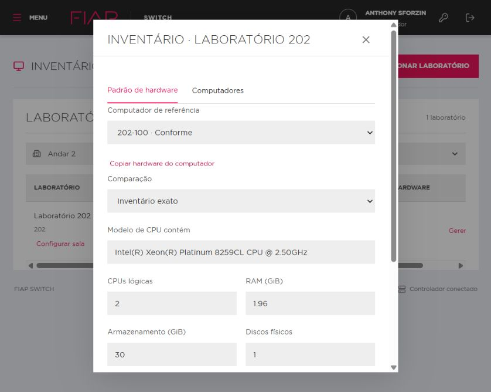

Na aba **Computadores**, a quantidade pode ficar **Indefinida**. Ao verificar o andar, a descoberta procura alunos de `.1` a `.99` e o professor em `.100`, somente na sub-rede da sala. Na FIAP, cadastra apenas computadores que respondem ao WinRM autenticado; em nuvem, VMs ligadas e autorizadas pelo provedor. Novos registros já entram na comparação de hardware e no histórico. Repetir o scan preserva o inventário e não duplica IPs ou números de computador. Máquinas desligadas que nunca foram cadastradas serão descobertas quando estiverem acessíveis.

Definir o total depois preserva os equipamentos cadastrados e adiciona os que faltam. A verificação aguarda o término da descoberta antes de salvar o resultado completo.

<details>
<summary>Ver quantidade indefinida e inventário detectado</summary>

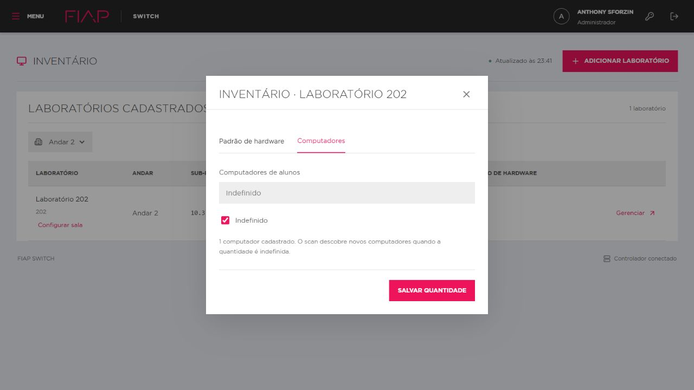
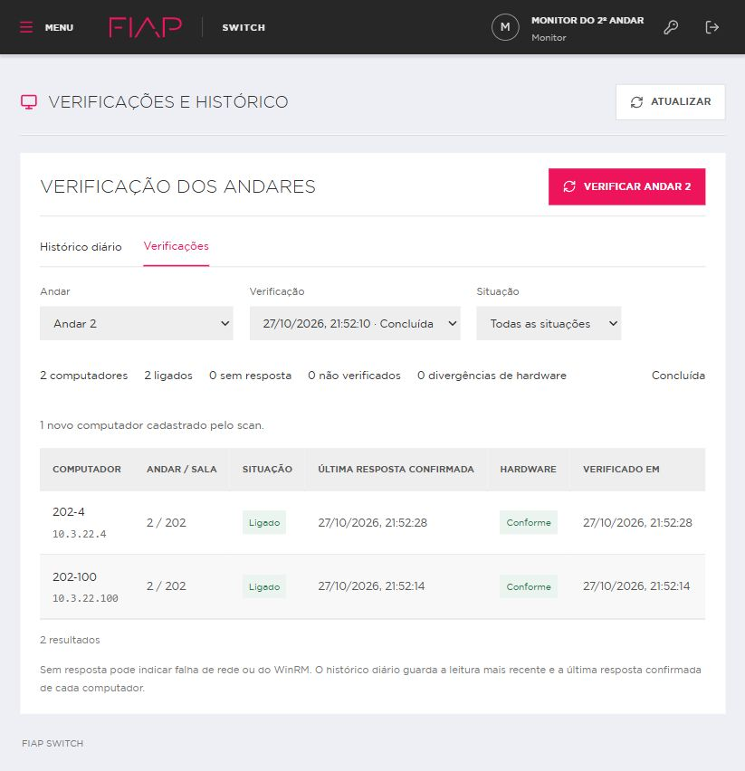
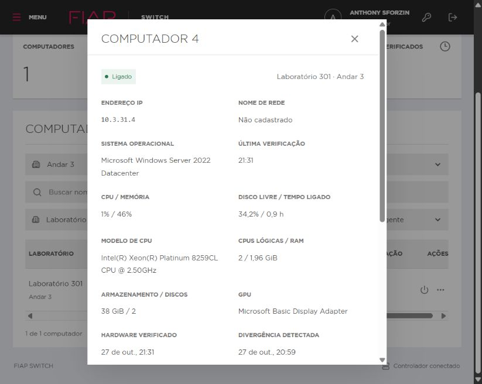

</details>

### Verificações e histórico

Uma verificação solicita leituras novas e salva o resultado. O histórico diário guarda a situação mais recente de cada computador e a última resposta confirmada, no fuso de São Paulo. Resolver uma divergência mantém seu registro anterior.

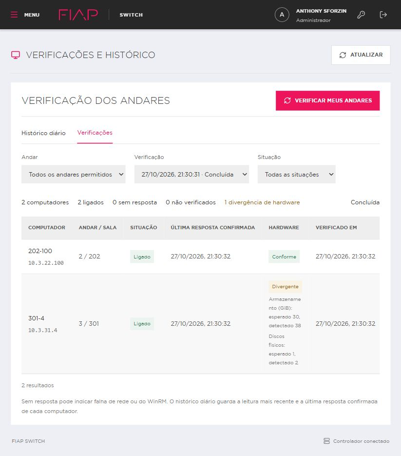

### Acesso por responsabilidade

| Perfil        | O que pode fazer                                                                    |
| ------------- | ----------------------------------------------------------------------------------- |
| Administrador | Gerenciar contas e andares; operar todos os laboratórios e seus inventários.        |
| Monitor       | Consultar e controlar somente os computadores do andar definido pelo administrador. |
| Suporte       | Operar todos os laboratórios e inventários, sem criar, excluir ou alterar contas.   |

As permissões são verificadas no servidor. Alterações de andar ou perfil encerram sessões antigas e são conferidas novamente antes da execução de um comando na fila. O suporte acompanha as ações dos monitores. Ações de administrador ficam privadas para a própria conta; administradores acompanham suporte e monitores.

<table>
<tr>
<td width="50%">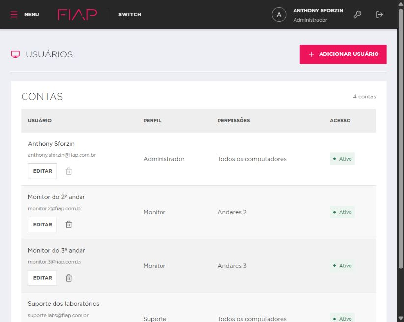</td>
<td width="50%">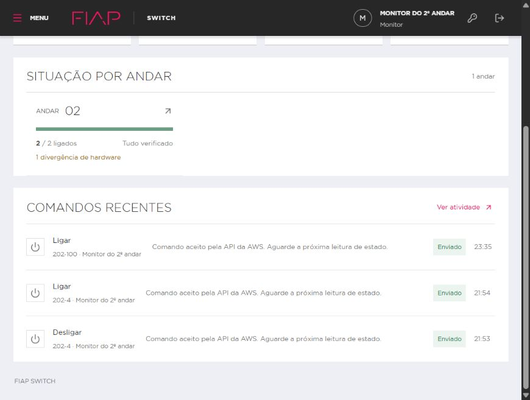</td>
</tr>
<tr>
<td align="center">Administração de acessos</td>
<td align="center">Visão restrita do monitor</td>
</tr>
</table>

As capturas mostram leituras reais de um laboratório Windows na AWS. Os IPs desse laboratório reproduzem o padrão de endereçamento informado para o projeto; nenhum inventário da rede real da FIAP é publicado.

## Como funciona

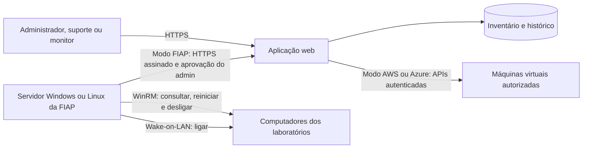

O site pode ficar hospedado fora do campus. Em FIAP produção, o controlador faz conexões de saída por HTTPS e executa apenas os comandos fixos permitidos. A rede da FIAP não precisa receber conexões da internet. O site não recebe a senha WinRM do domínio.

| Ação                        | Execução                                               |
| --------------------------- | ------------------------------------------------------ |
| Consultar estado e hardware | WinRM com consultas CIM do Windows.                    |
| Reiniciar ou desligar       | WinRM com aviso de 60 segundos para salvar o trabalho. |
| Ligar                       | Pacote Wake-on-LAN para o MAC cadastrado.              |

Essa tabela descreve o modo **FIAP produção**. Em **AWS**, ligar, desligar e reiniciar usam `StartInstances`, `StopInstances` e `RebootInstances`. Em **Azure**, usam `start`, `deallocate` e `restart`. O próprio site encontra a VM pelo IP privado dentro da VPC ou do grupo de recursos configurado, exigindo a tag `FIAPSwitchManaged=true`. Correspondências ambíguas são recusadas.

**O inventário em nuvem mostra a configuração da VM**, incluindo CPUs, RAM provisionada e discos anexados. Estado `running` não comprova a saúde do Windows. Uso de CPU, RAM e disponibilidade do WinRM são leituras do modo FIAP, não métricas inventadas a partir das APIs de nuvem.

### Aprovação do servidor da FIAP

Em **Controladores**, o administrador baixa o pacote para Windows ou Linux. O convite é individual, expira em 30 minutos e só pode ser usado uma vez. O instalador valida a assinatura Ed25519 e os arquivos do pacote. O servidor gera sua própria chave e aguarda a aprovação.

O painel mostra nome, sistema, IP de origem, endereços locais e impressão digital. Após comparar a impressão digital com o servidor, o administrador aprova a conexão. Revogar bloqueia novas consultas, resultados e comandos. Cada requisição tem assinatura, horário e nonce para impedir repetição.

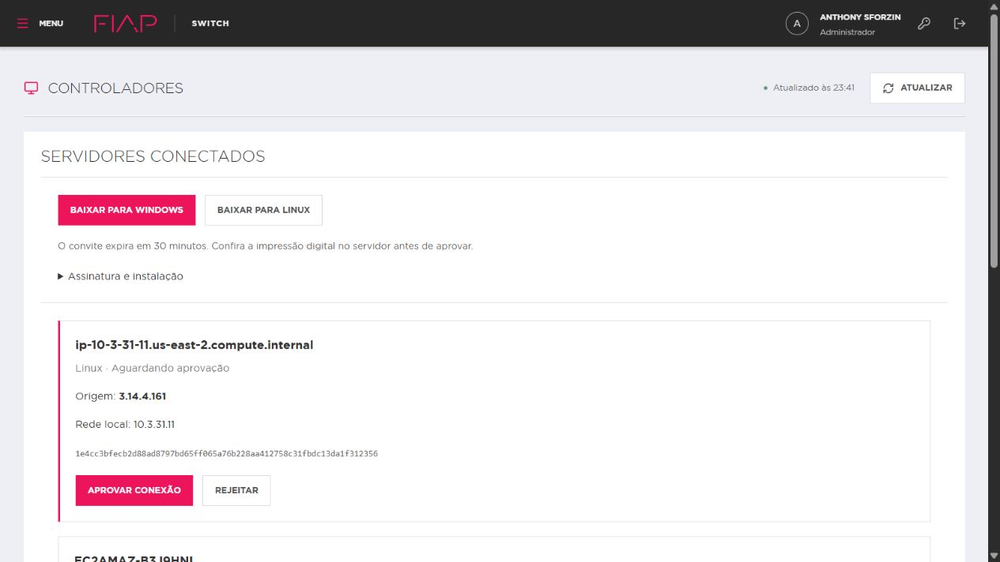

**Wake-on-LAN depende da rede e do equipamento.** BIOS/UEFI e placa de rede precisam permitir o ligamento remoto. Entre VLANs, pode ser necessário encaminhar broadcast ou usar um retransmissor autorizado. Acesso por IP atende ao WinRM, mas não garante a passagem do pacote de Wake-on-LAN.

### Endereçamento

O terceiro octeto junta o número do andar com o número da sala dentro daquele andar. O computador do professor usa `.100`.

| Sala | Andar | Rede            | Exemplo                        |
| ---- | ----- | --------------- | ------------------------------ |
| 301  | 3     | `10.3.31.0/24`  | `10.3.31.1`                    |
| 202  | 2     | `10.3.22.0/24`  | `10.3.22.100` para o professor |
| 1001 | 10    | `10.3.101.0/24` | `10.3.101.1`                   |

### O que cada situação significa

- **Ligado:** o WinRM respondeu na FIAP; em nuvem, a API confirmou a VM em execução.
- **Sem resposta:** na FIAP, a consulta falhou; em nuvem, a VM não está em execução.
- **Não verificado:** não há leitura atual ou o controlador está sem comunicação.

Um comando enviado não comprova que a máquina já mudou de estado. A confirmação vem da próxima leitura. Hardware sem leitura atual aparece como não verificado, preservando o último inventário e as divergências abertas.

## Executar localmente

### Instalação automática em Linux ou Windows

Requisitos: **Python 3.12+ e Docker com Compose**. O instalador prepara o ambiente, constrói a interface, inicia o site e mostra no terminal o e-mail e a senha aleatória do administrador inicial. Sem `--mode`, apresenta a escolha entre FIAP produção, AWS e Azure.

Linux:

```sh
sh setup.sh --mode fiap
```

Windows:

```powershell
.\setup.ps1 --mode fiap
```

Abra [localhost:8000](http://localhost:8000). Para um domínio com HTTPS configurado no proxy reverso, acrescente `--url https://switch.exemplo.com`. Configurações e contas existentes são preservadas em execuções posteriores. Guarde a senha exibida; o arquivo de configuração armazena somente seu hash.

Para escolher nuvem sem perguntas adicionais:

```sh
sh setup.sh --mode aws --aws-region us-east-2 --aws-vpc-id vpc-0123456789abcdef0
sh setup.sh --mode azure --azure-subscription-id SEU_UUID --azure-resource-group fiap-labs
```

Os exemplos representam instalações alternativas. Credenciais de nuvem pertencem ao **site**, usando perfil IAM, identidade gerenciada ou login de desenvolvimento pelo SDK. Nenhuma chave de nuvem é enviada ao navegador ou gravada pelo instalador. O site pode estar em Linux independentemente do modo escolhido.

AWS e Azure funcionam sem programa adicional. Em FIAP produção, entre com o administrador inicial e abra **Controladores** para gerar o pacote do servidor da LAN. Use `--no-start` para gerar a configuração do site e iniciá-lo manualmente.

### Instalação manual

Requisitos: **Python 3.12+**, **Node.js 24** e **npm**. No PowerShell:

```powershell
git clone https://github.com/5forzin/fiap-switch.git
cd fiap-switch
python -m venv .venv
.venv\Scripts\python -m pip install -r requirements-dev.txt
npm ci --prefix frontend
npm run build --prefix frontend

$env:ENVIRONMENT='development'
$env:BASE_URL='http://localhost:8000'
$env:COOKIE_SECURE='false'
$env:DATABASE_PATH='data/switch.db'
$env:SESSION_SECRET=[Guid]::NewGuid().ToString()+[Guid]::NewGuid().ToString()

.venv\Scripts\python -m scripts.create_admin --email admin@fiap.com.br --name Administrador
.venv\Scripts\python -m uvicorn backend.app:create_app --factory --host 127.0.0.1 --port 8000
```

Defina a senha quando o terminal solicitar. Abra [localhost:8000](http://localhost:8000), entre e cadastre os laboratórios e usuários. Um banco novo começa sem computadores fictícios e sem senha padrão.

### Controlador da LAN

Baixe e extraia o pacote em **Controladores**. Copie a impressão digital mostrada no painel. No servidor Windows, com **Python 3.12+ instalado para todos os usuários**, execute como administrador:

```powershell
.\instalar.ps1 -Fingerprint IMPRESSAO_DO_PAINEL
```

No Linux, com Python 3.12+ e suporte a `venv`:

```sh
sudo sh instalar.sh --fingerprint IMPRESSAO_DO_PAINEL
```

O instalador solicita a conta WinRM e a senha oculta. Para execução sem perguntas, informe `--config /caminho/privado.env --ca /caminho/ca.pem` no Linux, ou `-Config` e `-Ca` no Windows. O serviço roda com usuário próprio no Linux e Local Service no Windows. Aprove a solicitação na conta de administrador.

Use uma conta de serviço do domínio com os direitos necessários. O padrão é WinRM HTTPS na porta `5986`, NTLM, mensagens criptografadas e validação do certificado. Kerberos também é suportado. Consulte o [guia de operação](docs/operations.md) para certificados, permissões e backup.

## Autenticação e segurança

- Contas individuais com nome completo, e-mail `@fiap.com.br` e senha de pelo menos oito caracteres.
- Senhas com hash scrypt; não há cadastro público nem credenciais fixas.
- Cookies seguros, sessão de oito horas, proteção CSRF e limite de tentativas de entrada.
- Fila persistente com idempotência, expiração e autorização antes da execução.
- Pacotes assinados, convite de uso único, aprovação e revogação pelo administrador.
- Identidade própria do controlador e assinatura de cada requisição, com proteção contra repetição.
- Validação dos IPs, nomes e broadcasts permitidos pelo controlador.
- SSO Microsoft Entra opcional, sujeito ao cadastro da aplicação pela TI da FIAP.

<details>
<summary>Ver tela de entrada</summary>

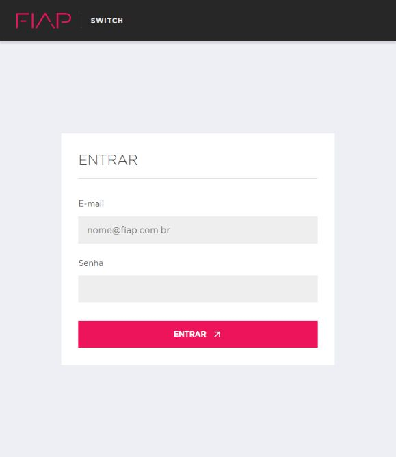

</details>

Arquivos de ambiente, chaves, bancos e credenciais ficam fora do Git. Nunca publique o conteúdo de `runtime/`. Nenhum software oferece segurança de 100%; os controles e os limites para revisão pela TI estão em [SECURITY.md](SECURITY.md).

## Validação

```powershell
.venv\Scripts\python -m pytest -q
npm run build --prefix frontend
```

A suíte possui **90 testes automatizados**. A validação de **27/10/2026** utilizou três alvos Windows Server 2022 reais, um controlador Windows e um servidor Linux temporário. Foram confirmados descoberta sem duplicação, restrição por andar, comandos reais, histórico, divergências de hardware, aprovação dos controladores e operação autossuficiente do site na AWS. A interface também foi exercitada com **1.188 computadores em uma base isolada**.

O monitor do 2º andar desligou e ligou uma EC2 pelo painel no modo AWS. Os três pacotes de Wake-on-LAN do modo FIAP foram recebidos e comparados com o MAC do alvo. O ligamento físico por Wake-on-LAN depende da LAN do campus, porque [VPC não oferece broadcast](https://docs.aws.amazon.com/vpc/latest/userguide/subnet-sizing.html).

Para a apresentação, `301-4` e `202-4` receberam um disco EBS real de **8 GiB** cada: **38 GiB e dois discos**, enquanto o padrão continua em **30 GiB e um disco**. O professor `202-100` permanece conforme. As máquinas de apresentação ficam ligadas.

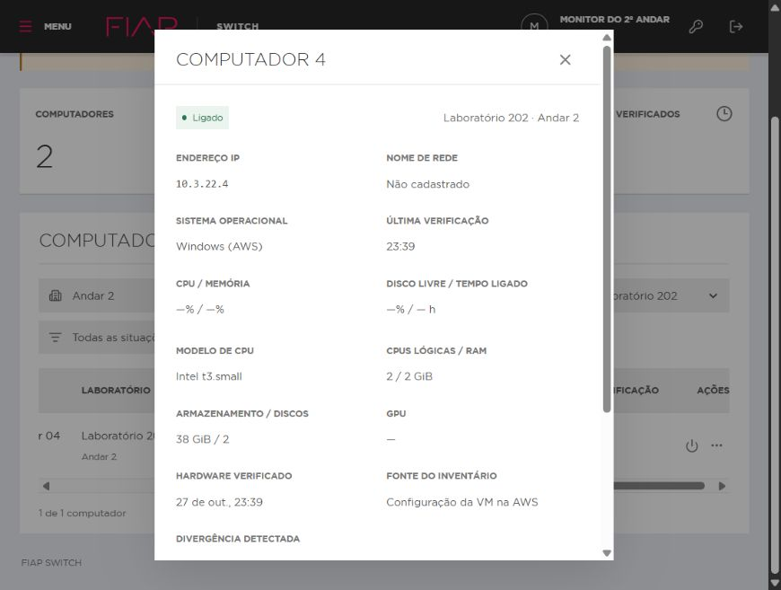

[Evidências das verificações](docs/validation-2026-10-27.json) · [Operação, contas e infraestrutura](docs/operations.md)

## Estrutura

| Diretório    | Responsabilidade                                                |
| ------------ | --------------------------------------------------------------- |
| `frontend/`  | Interface React e TypeScript, com identidade visual FIAP.       |
| `backend/`   | API FastAPI, autorização, fila SQLite, inventário e histórico.  |
| `collector/` | Controlador da LAN e comandos WinRM/Wake-on-LAN.                |
| `infra/`     | Preparação do laboratório AWS e dos servidores Windows.         |
| `scripts/`   | Administração, implantação e validação real.                    |
| `tests/`     | Testes de autenticação, permissões, fila, histórico e hardware. |
| `docs/`      | Capturas do painel, guia de operação e evidências.              |

## Identidade visual

O painel usa a [logo oficial da FIAP](https://www.fiap.com.br/svg/fiap.svg) e as fontes Gotham Book, Light e Bold observadas na [intranet](https://intranet.fiap.com.br/home). Marca e fontes pertencem aos respectivos titulares.

Projeto acadêmico independente. Este repositório não representa um serviço oficial da FIAP.
